# Client Local Database (Songs & Playlists)

Plan for storing songs and playlists in the client's Room database (`:common:database`, `KyokuDatabase`).

## Goals

1. Songs arrive from many responses (playlist import, search, home, artist pages). Each song is stored **once**, keyed by its server id, so any response updates the same row.
2. Playlists change through many actions (import, add/remove song, rename, reorder, visibility). Playlist membership lives in a link table, so each action is one small write.
3. The UI observes the database through `Flow`. Network responses only write to it.

## ERD

```mermaid
erDiagram
    PLAYLIST ||--o{ PLAYLIST_SONG : contains
    SONG ||--o{ PLAYLIST_SONG : "is in"

    SONG ||--o{ SONG_ARTIST : ""
    ARTIST ||--o{ SONG_ARTIST : ""

    SONG ||--o{ SONG_ALBUM : ""
    ALBUM ||--o{ SONG_ALBUM : ""

    SONG ||--o{ SONG_GENRE : ""
    GENRE ||--o{ SONG_GENRE : ""

    SONG ||--o{ SONG_COUNTRY : ""
    COUNTRY ||--o{ SONG_COUNTRY : ""

    SONG ||--o{ SONG_COMPOSER : ""
    COMPOSER ||--o{ SONG_COMPOSER : ""

    ALBUM ||--o{ ALBUM_ARTIST : ""
    ARTIST ||--o{ ALBUM_ARTIST : ""

    PLAYLIST {
        Long id PK "server playlistId"
        String name
        Long popularity
        String visibility "PUBLIC | PRIVATE"
    }

    PLAYLIST_SONG {
        Long playlistId PK, FK
        Long songId PK, FK
        Int position "ordering"
        Long addedAt
    }

    SONG {
        Long id PK "server songId"
        String title
        String poster "nullable"
        String masterPlaylist
        Int releaseYear "nullable"
        Long popularity
    }

    ARTIST {
        Long id PK
        String name
        String coverImage "nullable"
        Long followers
        Long monthlyListeners
        String birthDate "nullable"
        String biography "nullable"
    }

    ALBUM {
        Long id PK
        String name
        String poster "nullable"
        Long popularity
    }

    GENRE {
        Int id PK
        String name
        String coverImage "nullable"
        Long popularity
    }

    COUNTRY {
        Int id PK
        String name
        String code
    }

    COMPOSER {
        Long id PK
        String name
        String coverImage "nullable"
        Long followers
    }

    SONG_ARTIST {
        Long songId PK, FK
        Long artistId PK, FK
    }

    SONG_ALBUM {
        Long songId PK, FK
        Long albumId PK, FK
    }

    SONG_GENRE {
        Long songId PK, FK
        Int genreId PK, FK
    }

    SONG_COUNTRY {
        Long songId PK, FK
        Int countryId PK, FK
    }

    SONG_COMPOSER {
        Long songId PK, FK
        Long composerId PK, FK
    }

    ALBUM_ARTIST {
        Long albumId PK, FK
        Long artistId PK, FK
    }
```

All link tables:
- composite primary key
- foreign keys with `onDelete = CASCADE`
- an index on each FK column

## DAOs

### `SongDao`
- `@Upsert` for songs, artists, albums, genres, countries and composers.
- `@Transaction upsertFullSongs(...)`: upserts each song and its related objects, then replaces that song's link rows.
- `observeSong(id): Flow<SongWithRelations>`.

### `PlaylistDao`
- `@Transaction insertFullPlaylist(playlist, songs)`: upserts the songs (via the song write path), then rewrites the playlist's `playlist_song` rows.
- One small write per action: `addSong`, `removeSong`, `rename`, `updateVisibility`, `reorder`.
- `observePlaylists(): Flow<List<PlaylistWithSongs>>` and `observePlaylist(id)`.

Reads return Room `@Relation` / `@Junction` classes: `SongWithRelations`, `PlaylistWithSongs`.

## Consistency rules

- **Use `@Upsert`, never `OnConflictStrategy.REPLACE`.** REPLACE deletes the row first, and the cascade then removes that song from every playlist.
- **Partial responses must not overwrite fuller data.** Responses that carry fewer fields (for example a search result without `info`) use a partial upsert that only touches the fields they have, or skip null and empty values when merging.
- **One transaction per server response**, so observers never see half-written data.

## Layering

- **Shared domain models:** move `DtoSong`, `DtoPlaylist`, `DtoArtist`, `DtoAlbum`, `DtoGenre`, `DtoCountry`, `DtoComposer` and `DtoSongInfo` from `:setup:domain` to `:common:domain`, so `:common:database` and other features can use them.
- **Mapping and merge point:** `common/database/mapper/EntityMapper.kt` maps domain DTOs to entities and back.
  - `SongDao.upsertFullSongs` is the single merge point for songs from every feature.
- **Local datasources:** each feature follows the auth pattern.
  - Its domain module defines an interface, for example `SetupLocalDatasource`.
  - Its data module implements it as `RoomDatasource`, using the DAOs and the mapper.
- **Repositories write locally after each remote call.**
  - For example, `RemoteSetupRepository.importPlaylist`: remote call, then save locally, then return the result.
  - Viewmodels can later observe the DAO flows instead of keeping lists in memory.

## Migrations

`KyokuDatabase` currently uses `fallbackToDestructiveMigration(dropAllTables = true)`.

- Adding these tables bumps it to **version 2**.
- Once users have real imported data, schema changes need proper migrations. Otherwise the destructive fallback wipes their data.

## Implementation steps

1. Move the song and playlist domain DTOs to `:common:domain`.
2. Add the entities, link tables, relation classes and DAOs. Register them in `KyokuDatabase` and bump it to version 2.
3. Add the entity mapper. Register the DAOs in each platform's `databaseModule`. Add `SetupLocalDatasource` with its setup `RoomDatasource` implementation.
4. Make `RemoteSetupRepository.importPlaylist` save the imported playlist locally.
