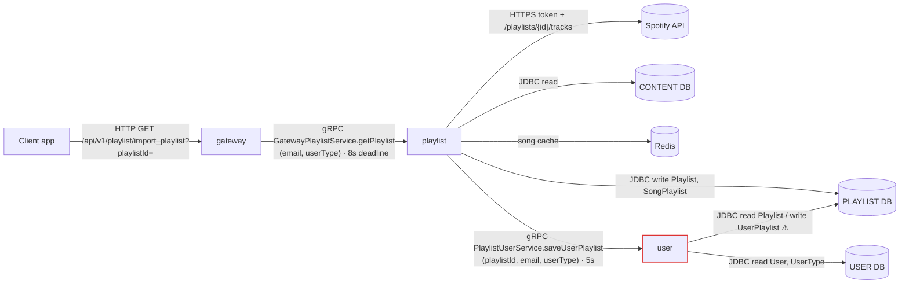
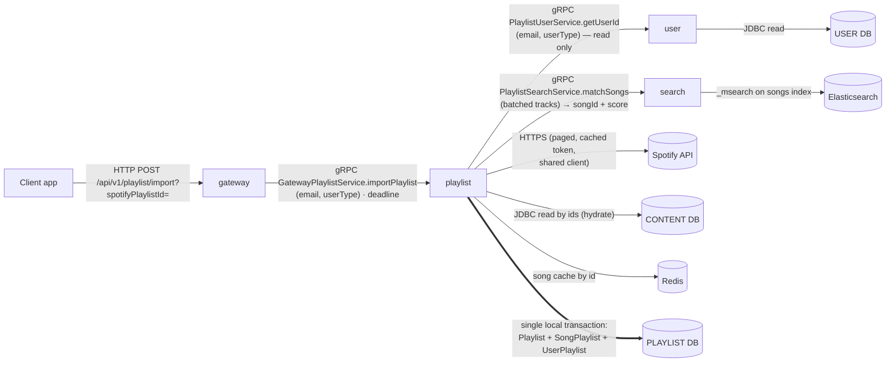
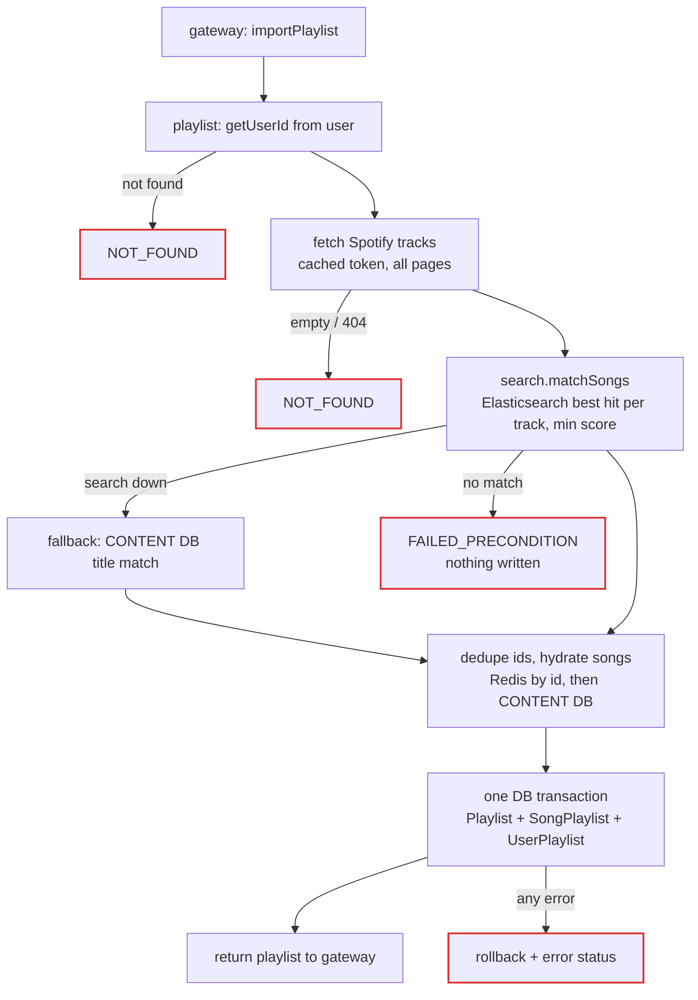

# Migration: Playlist Service Ownership & Import Flow Fix

Date: 2026-11-08
Status: **IMPLEMENTED (2026-11-08) — not yet built/run; see §9.** Client (KMP app) intentionally untouched.

Purpose: make the `playlist` service the single owner of the `PLAYLIST` database, make the
Spotify import flow correct (atomic, never hanging, no orphan rows), move song matching
from MySQL `REGEXP` to the Elasticsearch `songs` index (owned by `search`), and clean up the
contracts between `gateway`, `playlist`, `search` and `user`.

---

## 1. Current State

### 1.1 Inter-service communication (today)



### 1.2 Problems this migration fixes

| # | Problem | Where |
|---|---------|-------|
| P1 | `user` service writes `UserPlaylist` into the **PLAYLIST DB** (second writer on another service's DB). The intent is: PLAYLIST DB keeps the user reference, USER DB knows nothing about playlists. | `user/.../config/DatabaseConfig.kt` (`PlaylistDatasourceConfig`), `user/.../service/GRPCPlaylistUserService.kt`, `user/.../database/playlist/**` |
| P2 | Import is non-atomic: Playlist → song_count update → SongPlaylist → remote gRPC to `user`. Any failure leaves orphan rows. `@Transactional` is on a method that returns immediately (work runs in a detached coroutine) so it has no effect. | `playlist/.../service/GRPCGatewayRequestService.kt` |
| P3 | Detached `CoroutineScope(Dispatchers.IO).launch` without error handling → any exception leaves the gRPC call open until the gateway's 8s deadline. | same |
| P4 | Protobuf setters receive nullable values (`poster = song.poster`, `coverImage = genre.coverImage`) → NPE inside `onSuccess`, response never completed. | same, lines ~79 / ~155 |
| P5 | Playlist row is created (`async`) before checking whether any song matched → empty playlists persisted. | same |
| P6 | Default name `"Playlist #${count()+1}"` uses a global count, racy and not per user. | same |
| P7 | Spotify: no pagination (first 100 tracks only), no HTTP status check, token not cached, new `HttpClient` per call, full responses logged. | same |
| P8 | Song matching reads only `track.name`; one huge `REGEXP` alternation over the whole CONTENT `song` table (full scan); every substring hit is kept (e.g. "Love" → Lovegeet, Loveholic…). Fuzzy matching itself is required (content titles are `"<song> <movie/album>"`, no ISRC, not sanitised), but the already-populated Elasticsearch `songs` index (`kyoku-docker/elastic/song/`, ~69k docs with `title`, `artists.name`, `album.name`) is not used. | `PlaylistRepository.kt`, `SongDataSource.findSongIdsBySimilarTitles` |
| P9 | Title cache read key = Spotify title, write key = DB title → cache practically never hits; cached + DB results can duplicate; Jackson→Gson double conversion. | `RedisCacheService.kt`, `PlaylistRepository.kt` |
| P10 | `@Transactional(readOnly)` on a `suspend` fun / self-invocation / `withContext` thread hop → ineffective. | `PlaylistRepository.kt` |
| P11 | Proto contracts copy-pasted and drifted (`model.proto` vs inlined messages; `playlist_user` vs `playlistUser` java_package; `id` vs `songId`). | `playlist/src/main/proto/*`, `gateway/src/main/proto/gatewayPlaylist.proto`, `user/src/main/proto/PlaylistUserService.proto` |
| P12 | Status semantics: empty result returned as `CANCELLED`; gateway maps errors by `error.message.contains("NOT_FOUND")`, returns 204 with a body, labels missing `playlistId` as `UNAUTHORIZED`; `println`/`printStackTrace`. | `gateway/.../interceptors/setup/PlaylistInterceptor.kt` |
| P13 | Entity/SQL drift: `EntityUserPlaylist` FK name `fk_song_playlist` (SQL: `fk_user_playlist`); `description` NOT NULL in entity but nullable in SQL. | `playlist/.../database/playlist/entity/*` |
| P14 | Build hygiene: unused `spotify-web-api-java`, `jjwt`; mixed gRPC stacks (`spring-grpc` BOM + `net.devh`) with mismatched `net.devh` versions (2.15.0 vs 3.1.0); Gson/coroutines only transitive. | `playlist/build.gradle.kts` |
| P15 | `rpc getPlaylist` actually *imports/creates* a playlist (misleading name). | protos |

---

## 2. Target State

### 2.1 Ownership rules

- **PLAYLIST DB** — written and read **only** by `playlist`. Holds `Playlist`, `SongPlaylist`, `UserPlaylist(user_id, playlist_id)`. `user_id` is a reference to `USER.User.id` (no cross-DB FK).
- **USER DB** — owned by `user`. Holds no playlist data. `user` has **no** connection to the PLAYLIST DB.
- **Elasticsearch `songs` / `artists` indexes** — queried **only** by `search`. `playlist` never connects to Elasticsearch; it asks `search` to match tracks.
- **CONTENT DB** — `playlist` keeps its read-only JDBC access for now, used only to **hydrate** matched song ids into full songs (out of scope to move; see §6).
- Optional later: a local `PlaylistUser` copy (id + display fields) in PLAYLIST DB, kept fresh via user events — only if playlist ever needs user display data. **Not part of this migration.**

### 2.2 Inter-service communication (target)



### 2.3 Import sequence (target)



Key point: all remote/slow work (user lookup, Spotify, matching, hydration) happens **before** any write, and all writes happen in **one** local transaction in one service → no orphans, no distributed transaction.

---

## 3. Changes Per Service

### 3.1 `playlist` (main work)

**Contracts**
- `GatewayPlaylist.proto`: rename rpc `getPlaylist` → `importPlaylist`, request `RequestGetPlaylist` → `RequestImportPlaylist` (field `spotifyPlaylistId`). Fix `ResponseSong.id`/`songId` drift (single name, same field number 1 → wire compatible).
- `PlaylistUserService.proto`: replace `saveUserPlaylist` with `rpc getUserId(RequestUserId) returns (ResponseUserId { int64 userId })`.
- New `PlaylistSearchService.proto` (client side, copy of `search`'s contract, see §3.4): `rpc matchSongs(RequestMatchSongs) returns (ResponseMatchSongs)`. gRPC client `search` added to `application.yml` (`discovery:///search`, same pattern as `user`).

**Import flow** (`GRPCGatewayRequestService.kt`, split into smaller units)
- gRPC layer only: validate request → call a service → map result/exception to `onNext/onCompleted` or `onError`. One `try/catch` that **always** terminates the observer.
- Concurrency: **plain blocking code on the gRPC executor** (recommended, §7.5). Remove the detached `CoroutineScope(Dispatchers.IO).launch`, the `async` blocks and the Guava `FutureCallback`; use blocking stubs for `user` and `search`. Rationale: the only real parallelism today (save ∥ match) is removed on purpose (it causes empty playlists); JDBC/Redis block anyway; Spotify pages are sequential (`next` link). Blocking gives working `@Transactional`, gRPC cancellation propagation and guaranteed error handling with the least code.
- Order: resolve `userId` → fetch Spotify tracks → `search.matchSongs` → dedupe → if empty return `FAILED_PRECONDITION` (nothing written) → hydrate songs → persist.
- New `PlaylistWriter` (Spring `@Service`, non-suspend, `@Transactional("playlistTransactionManger")`) that in one transaction saves `EntityPlaylist` (with `totalSongs`, `totalDuration` set up front), `EntitySongPlaylist` rows and `EntityUserPlaylist`. Remove `updateTotalSongsById`.
- Default name: per user, e.g. `"Imported playlist"` or Spotify playlist's own name (fetch `GET /playlists/{id}?fields=name`). **Decision needed (§7).**
- Proto mapping moved to extension mappers (`DtoSong.toResponseSong()` …) and **every nullable field set via `?.let`**.

**Spotify client** (new `SpotifyClient` `@Component`)
- One shared Ktor `HttpClient` bean (closed on shutdown).
- Token cached until `expires_in - margin`.
- Follow `next` for pagination; read `track.name`, `track.album.name`, `track.artists[].name`; skip `null`/local tracks.
- Check HTTP status: 404 → `NOT_FOUND`, 401/403 → `UNAVAILABLE` / internal, 429 → `RESOURCE_EXHAUSTED`.
- Log at debug only, never full bodies at info.

**Song matching** — moved to `search` (see §3.4)
- `playlist` sends **one batched** `matchSongs` call per import with each track's `position`, `title`, `artists[]`, `album`. No per-track calls.
- Response: `position → songId + score` for tracks that cleared the minimum score. `playlist` dedupes song ids (two Spotify tracks can map to one song) keeping Spotify order.
- `search` unavailable / deadline → fall back to CONTENT DB title match (§7.3).
- `SongDataSource.findSongIdsBySimilarTitles` kept **only** as the fallback; unused `findSongsByIds` removed.

**Song hydration** (`PlaylistRepository.kt`) — existing batched fetch kept
- Input is now **song ids** (from `search`), not titles: `getSongsByIds(ids)`.
- Read `SONG:ID:` cache first; fetch only missing ids from CONTENT DB with the existing per-collection batched queries (artists, albums, genres, countries, song info, artist info); write them back to `SONG:ID:`.
- Return songs in the input id order.

**Cache** (`RedisCacheService.kt`)
- Drop the `SONG:TITLE:` group (title lookup now belongs to `search`); keep `SONG:ID:`. Add `getSongsByIds(ids)` multi-get.
- Use a typed serializer (or keep Jackson end-to-end) — remove the Jackson→Gson round-trip.

**Transactions**
- Content reads: `@Transactional("contentTransactionManger", readOnly = true)` on a public, non-suspend method of a separate bean (no self-invocation). With blocking code (§7.5) no thread hop occurs, so the transaction actually applies.

**Entities / config**
- `EntityUserPlaylist`: FK name → `fk_user_playlist`.
- `EntityPlaylist.description`: align with SQL (nullable) — or change SQL to `NOT NULL DEFAULT ''`. **Decision (§7).**
- `DebugUtils`: kept as is (no change).

**Build (`playlist/build.gradle.kts`)**
- Remove `spotify-web-api-java`, `jjwt-*` (unused).
- Pick one gRPC stack: keep `net.devh` (matches `gateway`/`user`), drop `spring-grpc` BOM, align `grpc-client-spring-boot-autoconfigure` to `3.1.0.RELEASE` (or drop it — the starter already includes it).
- Declare `com.google.code.gson:gson` explicitly. Coroutines are only needed inside `SpotifyClient` (Ktor) — declare `kotlinx-coroutines-core` explicitly, or replace Ktor with a blocking HTTP client and drop coroutines entirely (decided at implementation, no behaviour difference).

### 3.2 `user`

- `GRPCPlaylistUserService`: replace `saveUserPlaylist` with read-only `getUserId(email, userType)` → `NOT_FOUND` if user or type missing (fixes the current unchecked null).
- Delete `user/.../database/playlist/**` (entities, `PlaylistJPARepository.kt`) and `PlaylistDatasourceConfig` from `DatabaseConfig.kt`.
- Remove `spring.datasource.playlist` from `user/src/main/resources/application.yml` (and `sql.playlist` from the user profile in the config repo if defined there separately).
- Update `user/src/main/proto/PlaylistUserService.proto` to the new contract.

### 3.3 `gateway`

- `gatewayPlaylist.proto`: sync with playlist's version (renamed rpc/request).
- `PlaylistInterceptor.kt`:
  - Route `POST {service.path}import` (import creates data → not GET). **Decision (§7): keep path/verb for client compat or change.**
  - Missing param → 400 with `CustomResponseStatus` for bad request (not `UNAUTHORIZED`).
  - Map errors by `(error as? StatusRuntimeException)?.status?.code` instead of message strings: `NOT_FOUND`→404, `FAILED_PRECONDITION`→422/404, `DEADLINE_EXCEEDED`/`UNAVAILABLE`→503/504, else 500. No 204-with-body.
  - Replace `println`/`printStackTrace` with SLF4J logger.

### 3.4 `search` (new: track → song matching)

Why here: `search` is the only service that owns the Elasticsearch client, credentials and index knowledge (`ContentESRepository`, `ElasticConfig`). Keeping matching here avoids a second service coupled to the index mapping, keeps one ES connection config, and makes matching reusable (future YouTube/Apple Music import, in-app "add song"). Cost: one extra gRPC hop (a few ms) on a rare, already Spotify-bound request.

**Contract** — new `search/src/main/proto/PlaylistSearchService.proto`
```proto
service PlaylistSearchService {
  rpc matchSongs(RequestMatchSongs) returns (ResponseMatchSongs);
}
message RequestMatchSongs { repeated Track tracks = 1; }
message Track {
  int32 position = 1;          // index in the Spotify playlist
  string title = 2;
  repeated string artists = 3;
  optional string album = 4;
}
message ResponseMatchSongs { repeated Match matches = 1; }
message Match {
  int32 position = 1;
  int64 songId = 2;
  float score = 3;
}
```

**Implementation**
- New `@GrpcService` `GRPCPlaylistSearchService` → new repository method in a songs ES repository (same style as `ContentESRepository`).
- Config: add `elasticsearch.song.index: songs` next to the existing `elasticsearch.artist.index` in `search/src/main/resources/application.yml`.
- One `_msearch` request per call (chunked, e.g. 100 tracks per `_msearch`), `size = 1` per sub-query.
- Per-track query (`bool`):
  - `must`: `match` on `title` with the normalised Spotify title (lowercase, strip `(feat. …)`, `- From "…"`, `- Remastered…`, punctuation), `operator: and` falling back to `minimum_should_match` (e.g. 75%), `fuzziness: AUTO`.
  - `should` (boost): `match` on `artists.name` (each Spotify artist), `match` on `album.name`.
  - `must_not`: existing exclusion words (Remix, Mashup, LoFi, Slowed, Reverb, 8D, Nightcore, New Years) **unless** the Spotify title itself contains that word.
  - Tie-break on `popularity` desc.
- Return the top hit only if `_score >= minScore` (config value, tuned manually on real playlists); otherwise omit the track.
- Errors: ES down → `UNAVAILABLE`; empty request → `INVALID_ARGUMENT`.

**Known limitation (recorded, not fixed here)**
- The `songs` index is filled once by `kyoku-docker/elastic/song/import_data.py`; nothing keeps it in sync. Songs added to CONTENT DB later won't match until re-import. Future: index on content events or a re-index job.
- Note: `title` uses an edge-ngram index analyzer (`song_name_analyzer`) with `standard` search analyzer — fine for matching; `minScore` must be tuned with that in mind.

### 3.5 Client (`Kyoku/` KMP app)

- Only if §7 decides to change verb/path/field names: update the import-playlist request in the WIP client (`bc2ffe11 WIP: wip import playlist client`). Otherwise no change.

### 3.6 Database / infra (`kyoku-docker`)

- `mysql/playlist/sql/01_playlist_db.sql`: no structural change needed for ownership. Only add `IF NOT EXISTS` to `CREATE TABLE SongPlaylist` for consistency. Existing indexes are sufficient (PK prefixes cover `user_id` / `song_id` lookups; FKs index `playlist_id`).
- CONTENT DB: **no change** (FULLTEXT index no longer needed — matching moved to Elasticsearch).
- Elasticsearch: no mapping change; `songs` index must be present (`kyoku-docker/elastic/start.sh`).
- No data migration: existing `UserPlaylist` rows already live in PLAYLIST DB; they just become playlist-owned.

### 3.7 Shared protos (P11)

- Short term (this migration): manually keep the copies identical (same messages, same field names/numbers; `model.proto` imported where used). Applies to gateway↔playlist, playlist↔user and playlist↔search contracts.
- Long term (separate task): a shared proto module/artifact consumed by all services.

---

## 4. Rollout Order

1. **user**: add `getUserId` rpc (keep `saveUserPlaylist` temporarily so the old playlist build still works).
2. **search**: add `matchSongs` rpc + songs index config. Tune `minScore` manually against a few real Spotify playlists.
3. **playlist**: new contracts, blocking flow, writer, Spotify client, `search` client, id-based hydration, cache, build cleanup. Switch to `getUserId`; write `UserPlaylist` locally; remove `REGEXP` matching.
4. **gateway**: proto sync + interceptor error mapping (+ route change if approved).
5. **user**: remove `saveUserPlaylist`, playlist entities, playlist datasource and config.
6. Client update only if the HTTP contract changed.

Steps 1 and 2 are additive and deployable on their own; step 3 needs 1 and 2 running; step 5 only after step 3 is running.

## 5. Verification (manual — no new test cases)

- Import a real public Spotify playlist with >100 tracks → all pages fetched; response returned; rows in `Playlist`, `SongPlaylist`, `UserPlaylist` with correct `song_count`.
- Import a playlist with no matches → error returned, **no** `Playlist` row created.
- Invalid Spotify id → 404 at gateway quickly (not an 8s timeout).
- Kill `user` service → import fails fast with 503, nothing written.
- Kill `search` service → import still succeeds via DB fallback (log: `search unavailable … falling back`).
- Match quality: import a playlist with short/common titles (e.g. "Love…") → each track maps to at most one song, wrong matches noticeably fewer than with `REGEXP`; adjust `minScore` if needed.
- Call `search.matchSongs` directly with grpcurl (reflection) → ids + scores returned in one call.
- Repeat same import → `SONG:ID:*` cache hits, no CONTENT DB song queries, result identical.
- `user` service boots with no PLAYLIST datasource configured.

## 6. Out of Scope

- Moving `playlist`'s CONTENT DB hydration reads behind a `content` service "songs by ids" API.
- Keeping the Elasticsearch `songs` index in sync with CONTENT DB (events / re-index job).
- Local user replica + user events.
- Shared proto artifact.
- Other playlist features (create/rename/add song/delete) — none exist yet.

## 7. Decisions (final)

1. **Default playlist name**: Spotify playlist's own name (`GET /playlists/{id}?fields=name`); if missing/blank → `Playlist #N`, where **N = the new row's auto-increment id**, set inside the same insert transaction. MySQL guarantees id uniqueness, so concurrent imports can never collide and no lock / `count()` is needed. N is global (DB-based, not per user) and may skip numbers.
2. **HTTP contract**: `POST {playlist path}import` with JSON body `{"spotifyPlaylistId": "..."}`. Client update deferred.
3. **`search` unavailable** (`UNAVAILABLE` / `DEADLINE_EXCEEDED` / `UNIMPLEMENTED` / `INTERNAL`): **fall back** to CONTENT DB title match (chunked REGEXP, 50 titles per query).
4. **`Playlist.description`**: kept as is.
5. **Blocking** gRPC handler — implemented. Coroutines only inside `SpotifyClient` (`runBlocking` around Ktor).
6. **gRPC stack**: kept as is (incl. `spring-grpc` BOM and `net.devh` autoconfigure 2.15.0).

---

## 8. Revert

Nothing changed yet. After implementation, revert = restore the files listed in §3 from git. No DB or Elasticsearch mapping migration is involved.

---

## 9. Implementation Notes (2026-11-08)

Done in one pass (all services), so the temporary `saveUserPlaylist` compatibility step was skipped — deploy `user`, `search`, `playlist`, `gateway` together.

**user**
- `PlaylistUserService.proto`: `saveUserPlaylist` → `getUserId(RequestUserId) returns (ResponseUserId)`.
- `GRPCPlaylistUserService`: read-only, `NOT_FOUND` for missing user/type, `INVALID_ARGUMENT` for `DEFAULT` type.
- `UserDataSource.findByUserTypeAndEmail` now returns `EntityUser?`.
- Removed `PlaylistDatasourceConfig`, `database/playlist/**`, `spring.datasource.playlist`.
- Config repo: `sql.playlist` for the `user` profile can be removed (not in this repo).

**search**
- New `PlaylistSearchService.proto` (`matchSongs`), `GRPCPlaylistRequestService`, `SongESRepository` (`_msearch`, chunks of 100, `size=1`, `min_score`), `DtoSongMatch`.
- `application.yml`: `elasticsearch.song.index: songs`, `elasticsearch.song.min-score: 5.0` (**tune manually**).

**playlist**
- Protos: `importPlaylist(RequestImportPlaylist)`, `ResponseSong.songId`, `getUserId`, new `PlaylistSearchService.proto` (client copy).
- New: `ImportPlaylistService`, `SpotifyClient`, `UserClient`, `SongMatcher`, `PlaylistWriter`, `service/mapper/ProtoMapper.kt`, `ImportPlaylistException`, `DtoSpotifyPlaylist`, `SpotifyToken`.
- `GRPCGatewayRequestService`: thin blocking handler, always terminates the observer.
- `PlaylistRepository`: `findSongIdsByTitles` (fallback) + `getSongsByIds` (cache → DB), both on `contentTransactionManger`.
- `RedisCacheService`: only `SONG:ID:`; Redis errors treated as cache miss. `SONG_BY_TITLE` removed.
- `PlaylistDataSource.updateTotalSongsById` removed; `UserPlaylistDataSource` added; `EntityUserPlaylist` FK name fixed.
- `AppConfig`: shared Ktor `HttpClient` bean (timeouts, closed on shutdown).
- Build: removed `spotify-web-api-java`, `jjwt-*`; added explicit `gson`, `kotlinx-coroutines-core`.
- `application.yml`: gRPC client `search` → `static://localhost:9094` (search has no Eureka registration yet; override with `search.grpc.url`).
- `utils/DebugUtils.kt` kept unchanged; all playlist logging uses `DebugUtils` (`d` for debug/info/warn, `e` for errors), no SLF4J loggers in classes.

**gateway**
- `gatewayPlaylist.proto` synced; route `POST {path}import` with body `ApiRequestImportPlaylist`.
- Error mapping by gRPC status code: `INVALID_ARGUMENT`→400, `NOT_FOUND`/`FAILED_PRECONDITION`→404, `RESOURCE_EXHAUSTED`→429, `UNAVAILABLE`/`DEADLINE_EXCEEDED`→503, else 500. Deadline raised to 30s. SLF4J logging.

**Not verified**: nothing was compiled or run (Gradle wrapper is off-limits). Run each service's build and the §5 checks.
