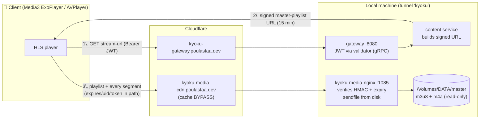
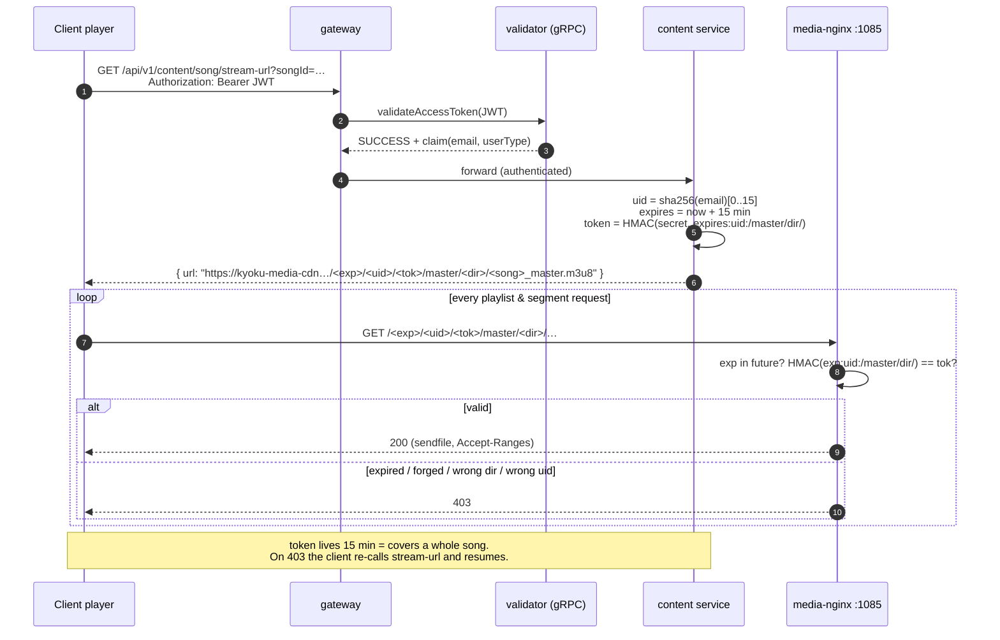
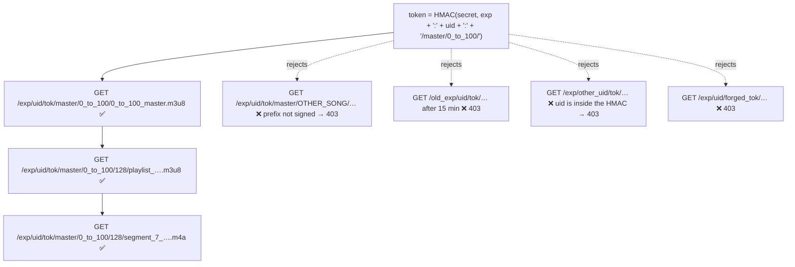
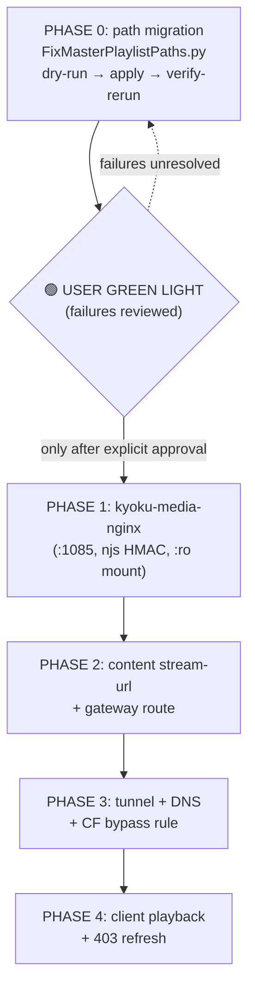

# Song Streaming Setup (HLS + signed URLs + nginx)

Status: **APPROVED PLAN — BLOCKED ON PHASE 0 (path migration)**

> ## 🛑 HARD GATE — read this first
>
> **No implementation work (Phase 1+) may start until:**
>
> 1. The master-playlist path migration (Phase 0, §4) has fully run with `--apply`,
> 2. `DataManipulationScripts/output/master_playlist_migration_failures.jsonl` has
>    been reviewed (every recorded failure resolved or explicitly accepted), and
> 3. **The user has given an explicit green light in the session.**
>
> If you are an implementation session reading this file and cannot confirm all
> three, do **only** Phase 0 work (or nothing) and ask the user.

Songs are **not** stored in MinIO. The raw HLS data lives on the external volume
`/Volumes/DATA/master/` and is served directly from disk by a new dedicated nginx,
with every request authenticated through short-lived, user-bound signed URLs.

## Decisions (locked — do not re-open)

| Decision | Value |
|---|---|
| Serving | New `kyoku-media-nginx` container, direct from disk, signed-URL-prefix auth verified in nginx (njs HMAC-SHA256). No MinIO, no JVM streaming. |
| Token TTL | **15 minutes.** A new token is issued per song via `stream-url`; a 3–5 min song finishes well inside it. Client refreshes on 403. |
| Public domain | **`kyoku-media-cdn.poulastaa.dev`** (mirrors `kyoku-image-cdn.poulastaa.dev`) → tunnel → `localhost:1085`. |
| Token scope | Signs `expires + uid + song-dir prefix`. **uid is embedded** so per-user rate limiting can be added in nginx later without changing the URL scheme. |
| uid format | `uid = first 16 hex chars of SHA-256(lowercase(email))` — stable, opaque, no PII in URLs/logs. |
| Master playlist fix | **Approved**: one-time on-disk rewrite via `DataManipulationScripts/FixMasterPlaylistPaths.py` (already written — run it, do not rewrite it). |
| DB | `song.master_playlist` needs **no** migration. |

---

## 1. What exists today (verified)

### 1.1 The song data (`/Volumes/DATA/master/`)

Fully packaged **HLS VOD** — no transcoding or segmentation at request time:

```
/Volumes/DATA/master/
└── 0_to_100/                            # one folder per song
    ├── 0_to_100_master.m3u8             # master playlist (bitrate selection)
    ├── 128/
    │   ├── playlist_0_to_100.m3u8       # media playlist (segment list)
    │   └── segment_0_0_to_100.m4a ...   # ~10 s AAC segments, ~260 KB each
    └── 320/
        ├── playlist_0_to_100.m3u8
        └── segment_*.m4a
```

Master playlist content (pre-migration):

```m3u8
#EXTM3U
#EXT-X-VERSION:3
#EXT-X-STREAM-INF:BANDWIDTH=128000
master/0_to_100/128/playlist_0_to_100.m3u8
#EXT-X-STREAM-INF:BANDWIDTH=320000
master/0_to_100/320/playlist_0_to_100.m3u8
```

> ⚠️ **Why Phase 0 exists:** those variant references are relative to the *server
> root* (`master/<song>/...`), not to the master playlist's own directory. HLS
> players resolve relative URIs against the playlist URL, so served as-is the
> variant URL becomes `/master/<song>/master/<song>/...` → 404. The media
> playlists are fine (plain file names). Phase 0 rewrites the master playlists to
> `128/playlist_….m3u8` / `320/playlist_….m3u8`.

Operational note: the volume is slow at directory enumeration (a bare
`ls /Volumes/DATA/master | wc -l` exceeded 2 minutes). Scripts must stream with
`os.scandir`, never pre-list; nginx must use `aio threads`.

- DB linkage: `song.master_playlist` (`content/.../database/entity/EntitySong.kt`,
  property `url`, length 300). No DB migration needed.

### 1.2 How images are served today (the pattern we mirror)

```
client → Cloudflare edge cache → tunnel "kyoku" → kyoku-static-nginx :1084 (disk cache) → MinIO bucket "cdn"
```

- Config: `kyoku-docker/nginx/static/static.conf.template` — GET-only, path
  sanitization, `server_tokens off`, `/health` endpoint, MinIO headers hidden.
- Compose service `kyoku-static-nginx` in `kyoku-docker/docker-compose.yml`
  (port `127.0.0.1:1084:80`, env via `NGINX_ENVSUBST_FILTER`).
- Public hostname `kyoku-image-cdn.poulastaa.dev` via the `kyoku` cloudflared
  tunnel — `kyoku-docker/cloudflare-tunnel.md` is the source of truth; update it
  in Phase 2.
- **Images are public (no auth). Songs must not be.**

### 1.3 How API auth works today

- Gateway (Spring Cloud Gateway) applies `ValidationFilter`
  (`gateway/src/main/kotlin/com/poulastaa/kyoku/gateway/interceptors/ValidationInterceptor.kt`):
  extracts `Authorization: Bearer <JWT>`, calls the **validator** service over
  gRPC (5 s deadline, retry on expiry), stores the claim
  (`DtoAuthenticationTokenClaim`: `email`, `userType`) in exchange attribute
  `authenticated-user`.
- Validator verifies the HMAC JWT in
  `validator/src/main/kotlin/com/poulastaa/kyoku/validator/service/JWTService.kt`
  (audience/subject/issuer checks, claim parsed from `jwt.access.claim.key`).
- Content routes under `/api/v1/content/**` already run behind this filter — the
  new endpoint reuses it; **no new auth code**.

---

## 2. Chosen approach: signed URL prefix verified in nginx

### 2.1 Rejected alternatives (do not revisit)

| Option | Verdict |
|---|---|
| Stream through gateway/content service (JVM) | ❌ Every ~10 s segment of every listener through Spring + a gRPC validation round-trip; no `sendfile`; gateway becomes the bottleneck. Services hand out URLs, not bytes. |
| MinIO presigned URLs | ❌ Songs are not moving to MinIO; S3 presigning is per-object, but the player follows relative playlist URIs which cannot carry per-object signatures. |
| JWT header on every segment request | ❌ nginx would have to verify JWTs (duplicated validator logic) or call the validator per segment (bottleneck); token refresh mid-song breaks playback. |
| Signed cookies | ⚠️ Fragile in mobile players, host-bound. Path tokens are simpler and CDN-agnostic. |
| **Signed URL prefix, verified in nginx** | ✅ One HMAC covers the song folder; relative-URI resolution keeps every follow-up request inside the signed prefix; nginx checks one local HMAC per request and serves via `sendfile`. Same pattern as CloudFront/GCS signed URLs. |

### 2.2 URL scheme (final)

```
https://kyoku-media-cdn.poulastaa.dev/<expires>/<uid>/<token>/master/<song_dir>/<file>
        │                              │         │     │       └── on-disk path under /Volumes/DATA/master ( = /media in container)
        │                              │         │     └── base64url( HMAC-SHA256(secret, "<expires>:<uid>:/master/<song_dir>/") ), no padding
        │                              │         └── 16 lowercase hex chars = SHA-256(lowercase(email))[0..15]
        │                              └── unix epoch seconds (UTC) when the grant dies (issue-time + 15 min)
        └── Cloudflare (cache BYPASS) → tunnel → localhost:1085
```

- The token signs the **directory prefix** `/master/<song_dir>/` (with trailing
  slash), not a single file → every URI the player derives (master playlist,
  variant playlists, all segments) is independently authenticated by recomputing
  one HMAC. No per-request backend call.
- `uid` in the path lets nginx key `limit_req` zones per user later (future work,
  not in scope now).
- Canonical string to sign: `"<expires>:<uid>:/master/<song_dir>/"` — exactly one
  colon between parts, prefix starts with `/` and ends with `/`. Kotlin signer and
  njs verifier MUST build the identical string.

---

## 3. Architecture

### 3.1 Big picture



### 3.2 Request flow



### 3.3 Why one token secures every request



---

## 4. 🟥 PHASE 0 — Master-playlist path migration (MUST finish first)

**Nothing else starts until this phase is done and the user says so.**

The script already exists: **`DataManipulationScripts/FixMasterPlaylistPaths.py`**.
Do not rewrite it; just run it. What it does:

- Walks `/Volumes/DATA/master/` with `os.scandir` (streaming — the volume is slow).
- For each song dir, rewrites URI lines in the top-level master `.m3u8` from
  `master/<dir>/<rest>` → `<rest>`. Media playlists and segments are untouched.
- **Idempotent**: already-relative lines are kept; a clean re-run reports
  `playlists_already_ok` and changes nothing.
- **Safety checks per file** (failure recorded, file left unmodified):
  - not a playlist (`#EXTM3U` missing), unreadable, undecodable;
  - URI referencing a *different* song dir (`prefix_mismatch`);
  - absolute URIs / `..` traversal in URIs;
  - rewritten target file missing on disk (`referenced_file_missing`);
  - directory unreadable or containing no `.m3u8` (`no_master_playlist`).
- Writes are atomic (temp file + `os.replace`).
- **Failure recording (review material for the green light):**
  - `DataManipulationScripts/output/master_playlist_migration_failures.jsonl` —
    one JSON object per failure: `song_dir`, `file`, `reason`, `detail`, `ts`.
  - `DataManipulationScripts/output/master_playlist_migration_report.json` —
    totals: dirs scanned, playlists seen/fixed/already-ok, failures, duration.
  - Exit code `1` if any failure occurred, `0` otherwise.

### Run procedure

```bash
cd ~/personal/Kyoku/DataManipulationScripts

# 1. Small dry-run sanity check (writes nothing)
python3 FixMasterPlaylistPaths.py --limit 50

# 2. Full dry-run (expect a long run — the volume is slow; run in background/tmux)
python3 FixMasterPlaylistPaths.py

# 3. Review output/master_playlist_migration_report.json and the failures file.
#    Only if the dry-run failure list is understood/acceptable:
python3 FixMasterPlaylistPaths.py --apply

# 4. Verify: re-run dry-run → expect playlists_fixed == 0, everything already_ok.
python3 FixMasterPlaylistPaths.py

# 5. Spot check a few songs:
head -10 "/Volumes/DATA/master/0_to_100/0_to_100_master.m3u8"
# variant lines must now read "128/playlist_….m3u8" / "320/playlist_….m3u8"
```

### Exit criteria (all required before Phase 1)

- [ ] Full `--apply` run completed.
- [ ] Verification dry-run shows `playlists_fixed: 0` and `failures` understood.
- [ ] Every entry in `master_playlist_migration_failures.jsonl` reviewed with the
      user — fixed, or explicitly accepted (e.g. folders with no master playlist
      that have no DB row).
- [ ] **User's explicit green light recorded in the session.**

---

## 5. PHASE 1 — Media nginx (`kyoku-docker`)

### 5.1 Files to create

| File | Purpose |
|---|---|
| `kyoku-docker/nginx/media/media.conf.template` | nginx server config (envsubst template, like `static.conf.template`) |
| `kyoku-docker/nginx/media/njs/media_auth.js` | njs module: HMAC verification |
| `kyoku-docker/docker-compose.yml` | add service `kyoku-media-nginx` |

### 5.2 Compose service (follow `kyoku-static-nginx` conventions)

```yaml
kyoku-media-nginx:
  image: nginx:1.27-alpine          # ships the njs dynamic module
  container_name: kyoku-media-nginx
  restart: unless-stopped
  ports:
    - "127.0.0.1:1085:80"   # cloudflared: kyoku-media-cdn.poulastaa.dev -> http://localhost:1085
  environment:
    MEDIA_TOKEN_SECRET: ${MEDIA_TOKEN_SECRET}
    NGINX_ENVSUBST_FILTER: "^MEDIA_"
  volumes:
    - ./nginx/media/media.conf.template:/etc/nginx/templates/default.conf.template:ro
    - ./nginx/media/njs:/etc/nginx/njs:ro
    - ${MEDIA_DATA_DIR:-/Volumes/DATA/master}:/media/master:ro
  healthcheck:
    test: ["CMD-SHELL", "wget -q -O /dev/null http://localhost/health"]
```

- Add `MEDIA_TOKEN_SECRET` to the `.env` used by compose (NOT committed). Generate
  with `openssl rand -base64 48`. The same value goes to config-server for the
  content service (§6).
- `njs` must be loaded in the **http/main** context. The template system only
  writes into `conf.d`; `load_module modules/ngx_http_js_module.so;` belongs in
  the main config. Simplest approach that keeps the stock image: mount a tiny
  `media-main.conf` into `/etc/nginx/conf.d/` is NOT enough (load_module is
  main-context) — instead mount a custom `nginx.conf` or use the image's
  `/etc/nginx/modules`-enabled variant. Implementation session: check how the
  official image enables njs (`/etc/nginx/nginx.conf` already includes
  `modules/*.conf` in recent images); if not, mount a one-line
  `/etc/nginx/modules-enabled` style include. Verify with `nginx -t` in the
  container before wiring the tunnel.

### 5.3 `media.conf.template`

Follows `static.conf.template` conventions (GET-only, traversal guard,
`server_tokens off`, `/health`, 404 default):

```nginx
js_import auth from /etc/nginx/njs/media_auth.js;
# js_set runs per-request; returns "1" only when expiry + HMAC check out
js_set $media_auth_ok auth.verify;

map $request_uri $media_raw_uri {           # strip query string, keep raw path
    ~^(?<path>[^?]*) $path;
}

server {
    listen 80;
    server_name _;
    server_tokens off;

    location = /health {
        access_log off;
        default_type text/plain;
        return 200 "ok";
    }

    # /<expires>/<uid>/<token>/master/<song_dir>/<file>
    location ~ ^/(?<expires>\d+)/(?<uid>[0-9a-f]{16})/(?<token>[A-Za-z0-9_-]{40,})/(?<song_path>master/[^/]+/.+)$ {
        limit_except GET { deny all; }

        # reject anything that could normalize differently (same guard as static.conf)
        if ($request_uri ~* "\.\.|%2e|%2f|%5c") { return 400; }
        if ($media_auth_ok != "1")              { return 403; }

        root /media;
        rewrite ^ /$song_path break;

        types {
            application/vnd.apple.mpegurl m3u8;
            audio/mp4                     m4a;
        }

        sendfile on;
        tcp_nopush on;
        aio threads;                 # external disk: don't block event loop on IO
        gzip off;                    # audio is already compressed

        # per-user tokenized URLs → never publicly cacheable
        add_header Cache-Control "private, max-age=900" always;
        add_header Accept-Ranges bytes always;
        add_header X-Content-Type-Options "nosniff" always;
    }

    location / { return 404; }
}
```

(Token length guard `{40,}` ≈ base64url of 32-byte HMAC = 43 chars, no padding.)

### 5.4 `media_auth.js` (njs)

Contract — must mirror the Kotlin signer exactly:

```js
// njs >= 0.7 ships a WebCrypto-like API; use crypto.subtle HMAC or njs' own
// require('crypto') createHmac — check what nginx:1.27-alpine's njs provides.
function verify(r) {
    // r.uri is the *decoded* URI: /<expires>/<uid>/<token>/master/<dir>/<file>
    var m = r.uri.match(/^\/(\d+)\/([0-9a-f]{16})\/([A-Za-z0-9_-]+)\/(master\/[^\/]+\/)/);
    if (!m) return "0";
    var expires = m[1], uid = m[2], token = m[3], prefix = "/" + m[4]; // "/master/<dir>/"

    if (parseInt(expires, 10) < Math.floor(Date.now() / 1000)) return "0";

    var data = expires + ":" + uid + ":" + prefix;
    var mac  = base64url(hmacSha256(process.env.MEDIA_TOKEN_SECRET, data));
    return timingSafeEqual(mac, token) ? "1" : "0";
}
export default { verify };
```

Implementation notes for the session doing this:

- `process.env` in njs requires `env MEDIA_TOKEN_SECRET;` in the **main** nginx
  config context, OR read the secret from a file mounted at a fixed path
  (e.g. `/etc/nginx/njs/secret` via a separate `:ro` mount) — file read via
  `fs.readFileSync` at module load is the simplest reliable option; prefer it.
- base64url = base64 with `+`→`-`, `/`→`_`, padding stripped.
- Constant-time compare: compare fixed-length digests (compute HMAC of both
  values and compare those) if no `timingSafeEqual` is available in njs.

### 5.5 Phase 1 verification (local only, no tunnel yet)

```bash
docker compose up -d kyoku-media-nginx
curl -s http://localhost:1085/health                        # ok
# Generate a test token (python3 one-liner mirroring the formula) and:
curl -I  "http://localhost:1085/<exp>/<uid>/<tok>/master/0_to_100/0_to_100_master.m3u8"   # 200
curl -I  "http://localhost:1085/<bad>/…"                                                  # 403
curl -I  "http://localhost:1085/<exp>/<uid>/<tok>/master/OTHER_DIR/file.m3u8"             # 403
curl -X POST "http://localhost:1085/<exp>/<uid>/<tok>/master/0_to_100/0_to_100_master.m3u8"  # 403/405
```

Helper for test tokens:

```bash
python3 - "$SECRET" 900 "0_to_100" <<'EOF'
import sys, time, hmac, hashlib, base64
secret, ttl, d = sys.argv[1], int(sys.argv[2]), sys.argv[3]
email = "test@test.com"
uid = hashlib.sha256(email.lower().encode()).hexdigest()[:16]
exp = str(int(time.time()) + ttl)
data = f"{exp}:{uid}:/master/{d}/"
tok = base64.urlsafe_b64encode(hmac.new(secret.encode(), data.encode(), hashlib.sha256).digest()).rstrip(b"=").decode()
print(f"/{exp}/{uid}/{tok}/master/{d}/")
EOF
```

---

## 6. PHASE 2 — Content service endpoint + gateway route

### 6.1 Content service (`content/`)

Follow the module's existing structure (`Endpoints.kt`, controller, service,
`ResponseWrapper` response shape — mirror how existing content endpoints are
built, including how they read the authenticated user forwarded by the gateway).

- **Endpoint:** `GET /api/v1/content/song/stream-url?songId=<id>`
- **Logic:**
  1. Load the song (`EntitySong`); 404 via the standard response wrapper if absent.
  2. `relPath = song.url` — on-disk relative path `master/<dir>/<file>.m3u8`
     (verified: no DB migration needed). Derive `dir` = path segment after
     `master/`; reject (500 + log) if the stored value doesn't match
     `master/<dir>/<file>` shape.
  3. `uid = sha256(email.lowercase()).toHex().substring(0, 16)` — email comes from
     the authenticated-user info the gateway already forwards to services.
  4. `expires = Instant.now().epochSecond + mediaTokenTtlSeconds` (config, 900).
  5. `data = "$expires:$uid:/master/$dir/"`
  6. `token = Base64.getUrlEncoder().withoutPadding().encodeToString(HmacSHA256(secret, data))`
  7. Respond `{ url: "$mediaBaseUrl/$expires/$uid/$token/$relPath", expiresAtSec: expires }`.
- **Config (config-server, same mechanism as `static-file.url`):**
  - `media.base-url: https://kyoku-media-cdn.poulastaa.dev`
  - `media.token.secret: <same value as MEDIA_TOKEN_SECRET>` (secret storage —
    follow however `jwt.access.secret` is provisioned today)
  - `media.token.ttl-seconds: 900`

### 6.2 Gateway (`gateway/`)

- Add the route for the new path following the existing content-service route
  pattern, **behind `ValidationFilter`** (same filter chain as current
  `/api/v1/content/**` routes — check `interceptors/` for where content routes
  are declared and mirror one).
- No validator/auth changes of any kind.

### 6.3 Phase 2 verification

```bash
TOKEN=<valid access JWT>
curl -s -H "Authorization: Bearer $TOKEN" \
  "http://localhost:8080/api/v1/content/song/stream-url?songId=1"
# → ResponseWrapper with url; then:
curl -I "<returned url with host swapped to localhost:1085>"    # 200
# No JWT → 401 from gateway; bad songId → 404 wrapper.
```

---

## 7. PHASE 3 — Tunnel + DNS + Cloudflare

Per `kyoku-docker/cloudflare-tunnel.md` (**update that doc as part of this phase**):

1. `~/.cloudflared/config.yml` — add above the `http_status:404` fallback:
   ```yaml
   - hostname: kyoku-media-cdn.poulastaa.dev
     service: http://localhost:1085
   ```
2. One-time DNS route: `cloudflared tunnel route dns kyoku kyoku-media-cdn.poulastaa.dev`
3. Cloudflare dashboard Cache Rule:
   `Hostname equals kyoku-media-cdn.poulastaa.dev` → **Bypass cache**.
   Tokens are per-user + 15-min expiry, so edge cache hits would be ~zero anyway;
   bypassing guarantees nothing is ever served past its token's expiry.
4. Restart the tunnel; verify:
   ```bash
   curl -I https://kyoku-media-cdn.poulastaa.dev/health            # 200 ok
   curl -I "https://kyoku-media-cdn.poulastaa.dev/<fresh signed path>"  # 200, CF-Cache-Status: BYPASS/DYNAMIC
   ```

---

## 8. PHASE 4 — Client (`Kyoku/` KMP)

- Android: Media3 ExoPlayer `HlsMediaSource` plays the returned URL as-is
  (master→variant→segment resolution + 128/320 ABR are native).
- iOS: AVPlayer — native HLS, same.
- Client logic needed:
  1. Before playback call `stream-url` for the song; feed the URL to the player.
  2. On HTTP 403 from the media host during playback (token hit the 15-min
     expiry, e.g. after pause): re-call `stream-url`, swap the media item,
     resume from the saved position.
  3. Pre-fetch the next queued song's URL just-in-time (TTL is only 15 min —
     do **not** batch-sign whole playlists ahead of time).
- Follow the existing client architecture for networking/DI/view-models; find the
  current player integration (if any) before adding one.

---

## 9. Security checklist

- [x] **Every request authenticated** — playlists *and* segments carry
      `expires/uid/token`; nginx verifies each one; every other path 404s.
- [x] Initial grant requires a valid access JWT (existing gateway `ValidationFilter`).
- [x] HMAC-SHA256 via njs (NOT `secure_link` — that's MD5); constant-time compare.
- [x] Token scoped to one song directory → leaked URL can't fetch other songs.
- [x] Token bound to user (`uid` inside the HMAC) → enables per-user rate limiting
      later; a stolen URL is attributable.
- [x] 15-minute expiry bounds the replay window to roughly one song.
- [x] `uid` is a truncated hash, not the email → no PII in URLs/CDN logs.
- [x] Secret only in compose `.env` + config-server; never committed.
- [x] Volume mounted read-only; GET-only; same path-traversal guards as image nginx.
- [x] No `Authorization` header ever sent to the media host (different origin).
- [x] Deliberately NOT binding tokens to client IP (mobile network hops + CGNAT
      would break playback). TTL + uid-binding are the mitigation.

---

## 10. Phase gates & verification summary



End-to-end acceptance: fresh token plays a full song on Android with bitrate
switching; tampered/expired/foreign-dir/foreign-uid URLs all 403; `POST` denied;
no path outside `/<exp>/<uid>/<tok>/master/...` serves anything.
